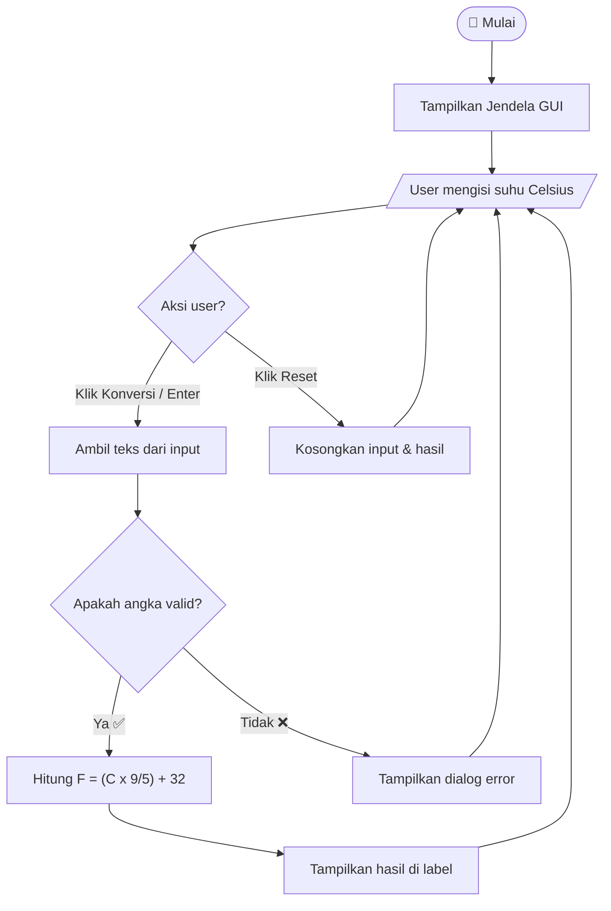
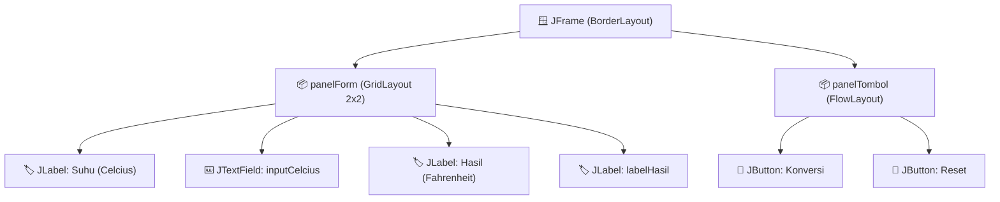
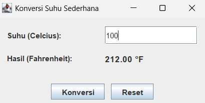

<div align="center">


<br/>


</div>

---

## 👤 Identitas Mahasiswa

| 📌 Keterangan | 📝 Data |
|:--------------|:--------|
| **Nama**      | *Iqbal Mauluddin* |
| **NIM**       | *F1D02510011* |
| **Kelas**     | *B* |
| **Mata Kuliah** | *Pemrograman Berorientasi Objek* |
| **Dosen Pengampu** | *Ibu Royana* |

---

## 📖 Tentang Program

**Konversi Suhu** adalah aplikasi desktop sederhana berbasis **Java Swing** yang mengubah suhu dari **Celsius (°C)** ke **Fahrenheit (°F)**. Program ini dibuat untuk mendemonstrasikan konsep dasar pemrograman GUI di Java.

> 🧮 **Rumus yang dipakai:**
>
> **°F = (°C × 9 / 5) + 32**

---

## ✨ Fitur Utama

- ⚡ **Konversi instan** lewat tombol *Konversi*
- ⌨️ **Tekan Enter** di kolom input untuk langsung menghitung
- 🔄 **Tombol Reset** untuk mengosongkan input dan hasil
- 🛡️ **Validasi input**: muncul dialog peringatan jika yang dimasukkan bukan angka
- 🎯 **Hasil 2 angka desimal** dengan format rapi (contoh: `98.60 °F`)

---

## 🔀 Alur Program

Klik bagian di bawah untuk membuka detailnya 👇

<details open>
<summary><b>📊 Diagram Alur (Flowchart)</b></summary>

<br/>



</details>

<details>
<summary><b>🧱 Struktur Komponen GUI</b></summary>

<br/>



</details>

<details>
<summary><b>🧠 Konsep Java Swing yang Digunakan</b></summary>

<br/>

| No | Konsep | Implementasi pada Kode |
|:--:|:-------|:-----------------------|
| 1 | **Top-level Container** | `JFrame` (`KonversiSuhu extends JFrame`) |
| 2 | **Intermediate Container** | `JPanel` → `panelForm` dan `panelTombol` |
| 3 | **Atomic Component** | `JTextField`, `JLabel`, `JButton` |
| 4 | **Layout Manager** | `BorderLayout`, `GridLayout`, `FlowLayout` |
| 5 | **Event Listener** | `ActionListener` (tombol) dan `KeyAdapter` (tombol Enter) |
| 6 | **Exception Handling** | `try-catch` untuk `NumberFormatException` |
| 7 | **Thread Safety** | `SwingUtilities.invokeLater()` |

</details>

<details>
<summary><b>⚙️ Penjelasan Method Penting</b></summary>

<br/>

| Method | Fungsi |
|:-------|:-------|
| `KonversiSuhu()` | Constructor: menyusun seluruh tampilan GUI dan mendaftarkan listener |
| `actionPerformed(ActionEvent e)` | Menangani klik tombol **Konversi** dan **Reset** |
| `hitungKonversi()` | Mengambil input, menghitung konversi, dan menampilkan hasil atau pesan error |
| `main(String[] args)` | Titik awal program, menjalankan GUI di *Event Dispatch Thread* |

</details>

---

## 🖼️ Tampilan Program

### ✅ Output Normal (Input Valid)

> 📂 Simpan screenshot kamu di folder `screenshots/` lalu ganti nama file sesuai di bawah.

<div align="center">

<!-- GANTI nama file sesuai gambar kamu -->


*Gambar 1. Hasil konversi suhu saat input berupa angka yang valid*

</div>

### ⚠️ Peringatan (Input Bukan Angka)

<div align="center">

<!-- GANTI nama file sesuai gambar kamu -->


*Gambar 2. Dialog peringatan "Masukkan angka yang valid!" saat input bukan angka*

</div>

---

## 🧪 Contoh Pengujian

| No | Input (°C) | Output (°F) | Keterangan |
|:--:|:----------:|:-----------:|:-----------|
| 1 | `0`    | `32.00 °F`  | Titik beku air ❄️ |
| 2 | `37`   | `98.60 °F`  | Suhu tubuh normal 🌡️ |
| 3 | `100`  | `212.00 °F` | Titik didih air ♨️ |
| 4 | `-40`  | `-40.00 °F` | Titik temu Celsius = Fahrenheit 🤯 |
| 5 | `abc`  | ❌ Dialog Error | Input bukan angka |
| 6 | *(kosong)* | ❌ Dialog Error | Input kosong |

---

## 🚀 Cara Menjalankan

<details open>
<summary><b>💻 Lewat Terminal / CMD</b></summary>

<br/>

```bash
# 1. Pastikan Java (JDK 8 atau lebih baru) sudah terpasang
java -version

# 2. Compile
javac KonversiSuhu.java

# 3. Jalankan
java KonversiSuhu
```

</details>

<details>
<summary><b>🧰 Lewat IDE (NetBeans / IntelliJ / Eclipse / VS Code)</b></summary>

<br/>

1. Buat project Java baru
2. Salin file `KonversiSuhu.java` ke folder `src`
3. Klik kanan file tersebut, lalu pilih **Run File**

</details>

---

## 📁 Struktur Folder

```text
📦 konversi-suhu
 ┣ 📂 screenshots
 ┃ ┣ 🖼️ output.png
 ┃ ┗ 🖼️ error.png
 ┣ 📜 KonversiSuhu.java
 ┗ 📄 README.md
```

---

## 💻 Source Code

<details>
<summary><b>👀 Klik untuk melihat kode lengkap</b></summary>

<br/>

```java
import java.awt.*;
import java.awt.event.*;
import javax.swing.*;

public class KonversiSuhu extends JFrame implements ActionListener {

    private JTextField inputCelcius;
    private JLabel labelHasil;
    private JButton btnKonversi, btnReset;

    public KonversiSuhu() {
        setTitle("Konversi Suhu Sederhana");
        setSize(350, 180);
        setDefaultCloseOperation(JFrame.EXIT_ON_CLOSE);
        setLocationRelativeTo(null);
        setLayout(new BorderLayout(10, 10));

        JPanel panelForm = new JPanel(new GridLayout(2, 2, 8, 8));
        panelForm.setBorder(BorderFactory.createEmptyBorder(15, 15, 5, 15));

        panelForm.add(new JLabel("Suhu (Celcius):"));
        inputCelcius = new JTextField();
        panelForm.add(inputCelcius);

        panelForm.add(new JLabel("Hasil (Fahrenheit):"));
        labelHasil = new JLabel("-");
        labelHasil.setFont(new Font("SansSerif", Font.BOLD, 14));
        panelForm.add(labelHasil);

        JPanel panelTombol = new JPanel(new FlowLayout(FlowLayout.CENTER, 10, 10));
        btnKonversi = new JButton("Konversi");
        btnReset = new JButton("Reset");
        panelTombol.add(btnKonversi);
        panelTombol.add(btnReset);

        add(panelForm, BorderLayout.CENTER);
        add(panelTombol, BorderLayout.SOUTH);

        btnKonversi.addActionListener(this);
        btnReset.addActionListener(this);

        inputCelcius.addKeyListener(new KeyAdapter() {
            @Override
            public void keyPressed(KeyEvent e) {
                if (e.getKeyCode() == KeyEvent.VK_ENTER) {
                    hitungKonversi();
                }
            }
        });
    }

    @Override
    public void actionPerformed(ActionEvent e) {
        if (e.getSource() == btnKonversi) {
            hitungKonversi();
        } else if (e.getSource() == btnReset) {
            inputCelcius.setText("");
            labelHasil.setText("-");
            inputCelcius.requestFocus();
        }
    }

    private void hitungKonversi() {
        try {
            double celcius = Double.parseDouble(inputCelcius.getText());
            double fahrenheit = (celcius * 9 / 5) + 32;
            labelHasil.setText(String.format("%.2f °F", fahrenheit));
        } catch (NumberFormatException ex) {
            JOptionPane.showMessageDialog(this, "Masukkan angka yang valid!", "Error", JOptionPane.ERROR_MESSAGE);
        }
    }

    public static void main(String[] args) {
        SwingUtilities.invokeLater(() -> {
            new KonversiSuhu().setVisible(true);
        });
    }
}
```

</details>

---

<div align="center">

### 🙌 Terima Kasih!

*Dibuat dengan ☕ dan Java oleh* **Iqbal**


</div>
